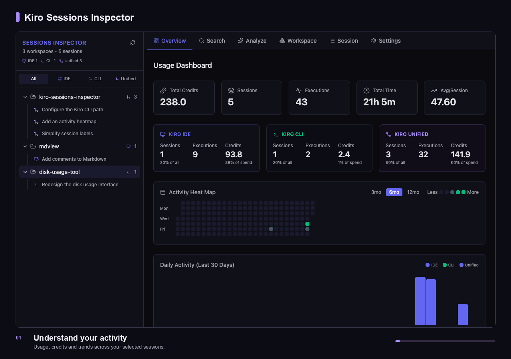

# Kiro Sessions Inspector

[](https://github.com/kirodotdev-labs/session-inspector-for-kiro/actions/workflows/release.yml)
[](https://github.com/kirodotdev-labs/session-inspector-for-kiro/releases/latest)
[](LICENSE)

Explore your [Kiro](https://kiro.dev/) IDE and CLI history in one desktop app.
Review conversations, inspect tool calls, search past sessions, and understand
your usage across projects—without setting up a server.

[Download](https://github.com/kirodotdev-labs/session-inspector-for-kiro/releases)
· [Build from source](#build-from-source)
· [Contribute](CONTRIBUTING.md)
· [Report an issue](https://github.com/kirodotdev-labs/session-inspector-for-kiro/issues)



## What you can do

- **Browse your history.** Find IDE, CLI, and unified sessions by workspace.
- **Inspect a conversation.** Expand tool calls to see inputs, outputs, and
  execution status, and explore subagent sessions when available.
- **Search across sessions.** Find conversations with full-text search, source
  filters, and highlighted matches.
- **Understand your usage.** View activity, credit usage, and model breakdowns
  across all projects or a single workspace.
- **Generate an analysis.** Use Kiro CLI to analyze the last day, week, or month
  and save an HTML report.
- **Pick up where you left off.** Copy a session ID or a CLI resume command
  from the session view.

## Get started

### Download the latest release

[](https://github.com/kirodotdev-labs/session-inspector-for-kiro/releases/latest/download/Kiro-Sessions-Inspector-macOS-Apple-Silicon.dmg)
[](https://github.com/kirodotdev-labs/session-inspector-for-kiro/releases/latest/download/Kiro-Sessions-Inspector-macOS-Intel.dmg)
[](https://github.com/kirodotdev-labs/session-inspector-for-kiro/releases/latest/download/Kiro-Sessions-Inspector-Windows-x64.exe)
[](https://github.com/kirodotdev-labs/session-inspector-for-kiro/releases/latest/download/Kiro-Sessions-Inspector-Linux-x64.AppImage)

1. Install and launch **Kiro Sessions Inspector** on the machine where you use
   Kiro. Sessions are discovered automatically.
2. Choose a workspace or session in the sidebar, or use **Search**.

**Not seeing older sessions?** Enable **Settings → Show non-unified sessions**
to include legacy IDE and CLI formats. Refresh the sidebar after creating new
sessions; use **Reindex** in Search to update search results.

**Installer warnings:** macOS builds are ad-hoc signed, not notarized; Windows
installers are unsigned. Your operating system may warn or block installation.
Follow your organization's security policy before proceeding.

### Optional: analyze your sessions

Install and authenticate Kiro CLI, then open **Analyze** and choose a time
window and tone. If the app cannot find `kiro-cli`, set its full path in
**Settings → kiro-cli → Binary path**.

Analysis uses Kiro's model service and may consume credits.

### Updates

The app checks for updates on launch. To check manually, use
**Settings → Check for updates**. Select **Install & restart** to apply an
available update. Updates require network access to GitHub.

## Privacy and local data

- **Browsing, dashboards, and search run locally.** Session files and the SQLite
  search index stay on your machine.
- **The search index retains content.** Deleting original session files does
  not remove their indexed content.
- **Analysis is opt-in and is not local-only.** It invokes Kiro CLI with
  summarized usage and tool-outcome data. The analyst can request additional
  session information, including your original prompts, through local MCP
  tools; that information becomes part of its model context. Raw tool inputs
  and outputs are excluded from those analysis tools.
- **Reports are stored locally.** Review reports, screenshots, and session
  excerpts for sensitive information before sharing them.

### Supported session formats

| Format | Default location |
| --- | --- |
| IDE | Kiro's `User/globalStorage/kiro.kiroagent/` directory |
| Legacy CLI (v2) | `~/.kiro/sessions/cli/` |
| Unified IDE + CLI (v3) | `~/.kiro/sessions/` |

For IDE sessions, the app looks under `~/Library/Application Support/Kiro/` on
macOS, `%APPDATA%\Kiro\` on Windows, and the system config directory (normally
`~/.config/Kiro/`) on Linux. The Windows IDE location is not yet verified.
Kiro's on-disk format changes may require an app update.

## Build from source

### Prerequisites

- Node.js **22.12+** and [pnpm](https://pnpm.io/installation) **10**.
- The stable [Rust toolchain](https://www.rust-lang.org/tools/install).
- The [Tauri platform prerequisites](https://v2.tauri.app/start/prerequisites/)
  for your operating system, including Xcode Command Line Tools on macOS,
  Microsoft C++ Build Tools and WebView2 on Windows, or the required WebKitGTK
  and system libraries on Linux.

```bash
git clone https://github.com/kirodotdev-labs/session-inspector-for-kiro.git
cd session-inspector-for-kiro
pnpm install --frozen-lockfile
pnpm tauri dev
```

`pnpm dev` runs only the frontend; native session access requires `pnpm tauri dev`.

### Development commands

| Command | Purpose |
| --- | --- |
| `pnpm tauri dev` | Run the desktop app with live frontend updates |
| `pnpm lint` | Run ESLint |
| `pnpm build` | Type-check and build the frontend |
| `cargo test --manifest-path src-tauri/Cargo.toml` | Run Rust tests |
| `pnpm tauri build` | Build the desktop app and native bundles |

Installers are written to `src-tauri/target/release/bundle/`. Build on each
target operating system.

### Project structure

```text
src/                    React + TypeScript interface
  components/           Dashboards, session viewer, search, analysis, settings
  lib/                  Native API bindings and shared UI state
src-tauri/src/
  sessions/             Session discovery and format parsers
  search/               SQLite full-text search index
  analysis/             Kiro CLI analysis and report storage
  mcp/                  Tools used by the analyst
```

## Documentation and contributing

- [Contributing guidelines](CONTRIBUTING.md) and [Code of Conduct](CODE_OF_CONDUCT.md)
- [Release and updater guide](docs/RELEASING.md)

For bugs and feature requests, use the
[issue tracker](https://github.com/kirodotdev-labs/session-inspector-for-kiro/issues).
Include your app version, operating system, and steps to reproduce. Redact
private prompts, paths, credentials, and tool output from any attachments.

**Security issues:** follow the
[private reporting instructions](CONTRIBUTING.md#security-issue-notifications)
rather than opening a public issue.

## License

Licensed under [Apache-2.0](LICENSE).
[Notices](NOTICE) · [Third-party licenses](THIRD-PARTY-LICENSES)
